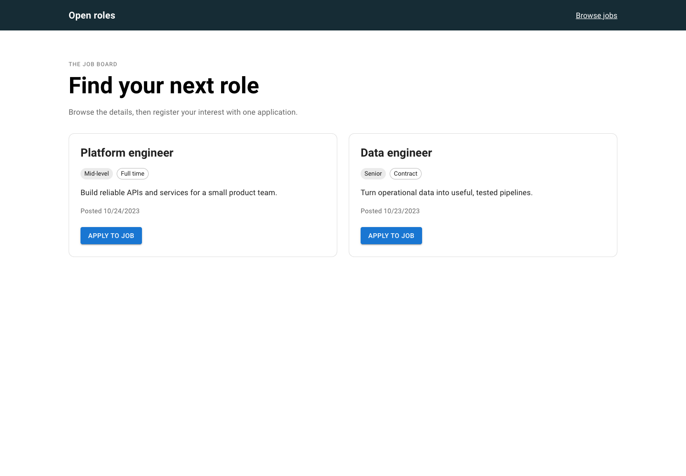

# A small job board, end to end

A React client and an Express/Prisma API for browsing seeded roles and recording a signed-in user's interest. An application is a user ID attached to a job: there is no CV upload, employer review workflow, email delivery, or hiring pipeline.



The useful engineering detail is the application boundary. The browser waits for a successful save before showing **Applied**, disables repeated clicks while saving, and leaves a retry after a failure. PostgreSQL receives a conditional atomic array push, so concurrent applicants do not overwrite a read-modify-write snapshot and the same user is not appended twice. That database behavior still needs an integration test against PostgreSQL.

## Where things live

| Directory | Responsibility |
| --- | --- |
| `jobs-web/src/pages/Jobs` | Loading, error, empty, and listing states |
| `jobs-web/src/components/Job` | Per-role application and retry |
| `jobs-server/src/controllers` | Registration, login, listings, applications |
| `jobs-server/src/helpers/jwtHelper.ts` | Required signing key, HS256 verification, one-hour expiry |
| `jobs-server/prisma` | PostgreSQL schema, migration, demo seed |

Requests go from React through Axios to Express at `/api`, then Prisma to PostgreSQL. UUIDs are strings throughout. The frontend cookie is a display hint; API authorization comes from a verified token.

## Run locally

Use a local PostgreSQL database and a compatible Node installation. The project originated on Node 18; the source checks and frontend build were verified on Node 22. Legacy dependencies remain, so keep this as a local exercise until they and the deployment controls have been reviewed.

From `jobs-server`:

```sh
npm ci --ignore-scripts
cp .env.example .env
node -e "console.log(require('node:crypto').randomBytes(32).toString('hex'))"
```

Put your database connection in `DATABASE_URL` and the generated private value in `JWT_KEY`. Never commit either. The API refuses signing keys shorter than 32 characters. Native bcrypt may require its platform binary or a build after dependency review; installation scripts were intentionally skipped during verification.

```sh
npx prisma generate
npx prisma migrate deploy
npx prisma db seed
npm run dev
```

The seed writes demonstration users and roles to the configured database. Use a dedicated disposable database, never a production database. The API binds to `127.0.0.1:8080` by default.

In a second terminal, from `jobs-web`:

```sh
npm ci --ignore-scripts
cp .env.example .env
npm start
```

Open `http://localhost:3000`, register, sign in, and browse roles. `REACT_APP_API_URL` should include `/api`; restart the client after changing it.

## API sketch

| Method | Path | Behavior |
| --- | --- | --- |
| POST | `/api/auth/signup` | Register with name, email, password |
| POST | `/api/auth/login` | Return a token and user ID |
| GET | `/api/jobs?title=engineer` | List roles, optionally filter title |
| POST | `/api/jobs/apply` | Save `{"jobId":"<job UUID>"}` for the verified user |

Protected requests use the existing `authtoken` header. The browser reads the current cookie for each request, rather than capturing the pre-login value. Successful responses use the existing `payload` envelope.

## Checks and limits

Backend: `npx tsc --noEmit` and `node -r ts-node/register --test tests/auth-boundary.test.cjs`. Frontend: `CI=true npm test -- --watchAll=false --runInBand` and `npm run build`. The legacy backend Mocha suite needs a separately configured PostgreSQL database and was not run.

The screenshots use invented roles and an intercepted API, not live accounts or a live database. Browser checks cover a failed application, retry, successful state, and a 390 px layout.

Before hosting: add login rate limits, pagination, authorization appropriate to employer/admin roles, a tested relational application model, and server-managed sessions or equivalent XSS protection. Current tokens are JavaScript-readable cookies; signing out/revoking active tokens and server-side session management are not implemented. Listing responses expose applicant IDs to signed-in users. There is no application-management UI.

